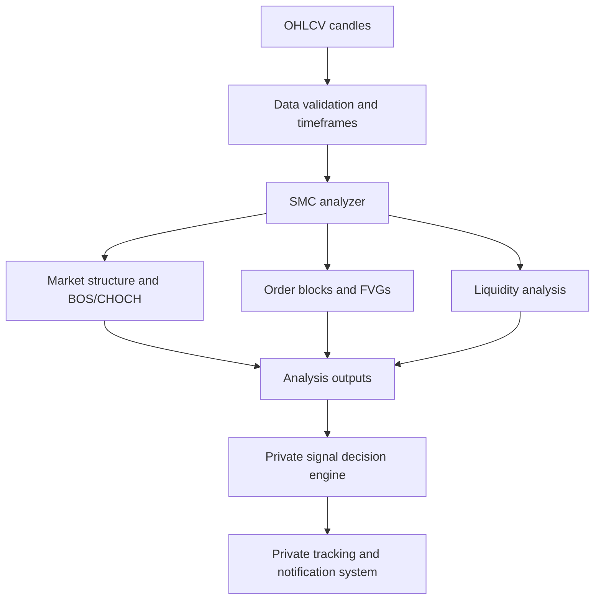

# SMC Market Structure Engine

**Python / financial market data / algorithm design / historical validation**

I built a trading bot around Smart Money Concepts (SMC). This page documents the analysis side of that project: identifying swings, structural breaks, order blocks, fair value gaps and potential liquidity levels from OHLCV candles.

The complete bot is private. In particular, this write-up does not disclose signal generation, entry selection, confluence scoring, risk rules, or exchange execution.

## The problem

Chart concepts such as an order block or change of character are often interpreted visually. For software, I needed detection rules that operate on candle data consistently, produce inspectable outputs, and can be tested against historical data.

The analyzer uses Python, Pandas and NumPy. Individual methods return labeled series or DataFrames instead of executing trades. Keeping the detections separate makes it easier to test them without involving the private decision engine.

## Analysis components

| Component | What I implemented |
| --- | --- |
| Swing detection | Candidate highs and lows identified over a configurable candle window |
| Market structure | Higher highs, higher lows, lower highs and lower lows derived from successive swing points |
| BOS / CHOCH | Structural-break annotations based on detected swings and price breaks |
| Order blocks | Bullish and bearish candidate zones with retrospective mitigation tracking |
| Fair value gaps | Three-candle imbalance detection and later zone interactions |
| Liquidity | Clustering of nearby swing levels and checking later sweeps |

These are definitions from my implementation, not universal definitions of SMC.

## Architecture

Only the analyzer side is intended for public source release. This chart provides context without revealing the implementation of the private components.

## Engineering details worth explaining

### Pivot confirmation is delayed

A swing detector using a window on both sides of a candidate candle cannot know the final swing label at the candle's own timestamp. The label may be placed at that historical candle, but enough later candles must arrive before it can be confirmed.

This distinction matters when evaluating a live system using historical charts. A backtest that uses the final label too early can accidentally consume future information.

### Zone detection and mitigation aren't the same event

Finding an order block or FVG and recording a later interaction with that zone are different operations. The historical analyzer can annotate a zone with its eventual mitigation index, but a signal made at zone formation must not rely on that future index.

### Correctness can be a data-timing problem

During historical evaluation I identified a liquidity-session filter that read the actual current time instead of the timestamp of the candle under test. I changed the implementation so a historical evaluation can use the candle's reference time. That is a simple bug with a large potential effect: the program can run normally while evaluating the wrong trading session.

Other work documented in the private optimization report includes trade-exit handling, reducing unnecessary Fibonacci calculations and making confluence diagnostics available for analysis.

## Historical evaluation

The private system was researched on BTCUSDT data covering January–August 2026 and separately evaluated against January–December 2025 historical data.

The optimization report describes **337 trades, approximately 64% wins, and 6.8% maximum drawdown** for the 2025 validation. These are **reported historical simulation figures**, not independently reconstructed results or live-account performance. The trade-level records are not part of this public showcase.

The earlier 2025 period was held out from the initial 2026 optimization, but historical testing against an earlier period is not chronological live forward testing. Research performed after looking at validation results may also weaken their status as an untouched holdout.

A candle-based simulation has additional assumptions about fills, fees, slippage and what happens when both stop and target are inside one candle. Those assumptions need to be stated before interpreting performance as achievable execution.

## Testing and limitations

The extracted analyzer draft has three automated tests that check output shapes, short-history behavior and a synthetic bullish FVG. They passed in the draft environment. That test suite is intentionally limited: it does not establish causal correctness for every SMC detector or validate the private strategy.

I have not published a reproducible latency benchmark, live trading return series or trade-by-trade dataset.

## Code availability

A standalone, curated analyzer implementation is prepared for a separate public repository. I will publish only the reviewed detection methods and their tests, not the original bot file or any confidential trading logic.

---

This is a software engineering case study, not an investment recommendation.
